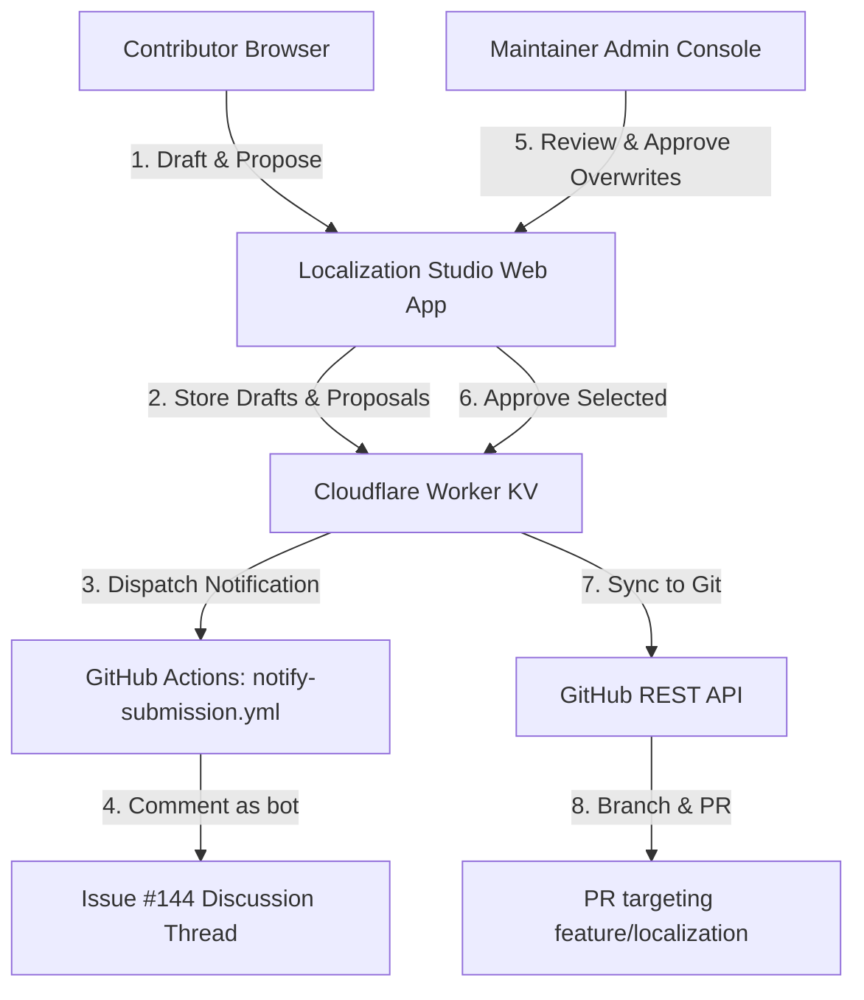

# 🌐 Tunetastic Community Localization Studio

Welcome to the **Tunetastic Community Localization Studio** (`gh-pages` branch).

This repository powers the live web portal hosted at [**amit-kp.github.io/Tunetastic**](https://amit-kp.github.io/Tunetastic/), enabling music lovers and volunteers worldwide to translate [Tunetastic](https://github.com/AMit-KP/Tunetastic) into their native languages without needing Git, forks, or technical software localization knowledge.

---

## 🌟 Key Features

### 1. Zero-Login & Instant Cloud Autosave
* **No Sign-Up Needed**: Contributors translate directly in their web browser. No GitHub account or third-party login is required.
* **48-Hour Sliding Drafts**: Active drafts are automatically saved to Cloudflare KV and extended as you type. If you close your browser or step away, you can resume right where you left off.
* **Tab & Incognito Isolation**: Drafts are safely isolated across browser tabs using session storage, while Incognito mode operates in a zero-network private sandbox.

### 2. In-App Context & Real-Time WinUI Preview
* **Context Annotations**: Every string indicates its exact location in Tunetastic (e.g., *Player Controls, Equalizer, Settings, Playlist Overlays*).
* **Live In-App Preview**: Shows how translated text fits into simulated WinUI dialogs, action bars, and buttons.
* **Token Protection**: Automatically detects formatting placeholders (e.g., `{0}`, `{1}`) and flags any missing tokens before submission to avoid runtime format exceptions.

### 3. Multi-Proposal Stacks & Exact-Match Guard
* **Community Proposals**: Strings accept up to 10 community proposals. If a phrase is already translated or in progress, contributors can click **Suggest Alternative** to propose refined wording.
* **Deduplication Guard**: Exact and whitespace-duplicate submissions are automatically blocked on both the client and Cloudflare Worker.

### 4. Admin Quality Control & Before-and-After Diff Comparison
* **Secure Admin Console (`#admin`)**: Password-protected dashboard for project maintainers.
* **Language Grouping**: Submissions are grouped by language with per-locale and global review metrics.
* **Overwrite & Revision Highlighting**:
  * <span style="color: #fbbf24; font-weight: bold;">⚠️ Overwrite: Approved</span> — Flags proposals that modify a translation already staged as approved.
  * <span style="color: #38bdf8; font-weight: bold;">🔄 Revision: Translated</span> — Flags proposals that modify an active official translation merged into the application.
* **Interactive Diff Comparison**: Side-by-side comparison pane (`WHAT WAS BEFORE` vs. `WHAT IS SUGGESTED`) that updates live when cycling through proposals or tweaking custom text.

### 5. Automated Git Sync & Multi-Contributor Recognition
* **Automated Pull Requests**: With a single click in Admin, the Cloudflare Worker creates a dedicated branch (`refs/heads/l10n/sync-<lang>-<timestamp>`) from `feature/localization`, compiles `.resw` XML resource dictionaries, and opens a Pull Request against `feature/localization`.
* **Full Contributor Credit**: If multiple contributors submitted ideas or revisions for a string, **every contributor is credited** in the Pull Request body, release notes, and GitHub tracker issues.
* **Issue Tracker Notifications**: Automatically dispatches `notify-submission.yml` to post status updates to Issue [#144](https://github.com/AMit-KP/Tunetastic/issues/144) under `github-actions[bot]`.

---

## 📁 Repository Structure

```text
Tunetastic-gh-pages/
├── .github/
│   └── workflows/
│       └── (Production workflows live on 'master' branch)
├── assets/
│   ├── favicon.ico
│   ├── logo-dark.png
│   └── app-icon.png
├── cloudflare-worker/
│   ├── worker.js            # Serverless API: drafts, approvals, and automated PR sync
│   └── wrangler.toml        # Cloudflare KV bindings and configuration
├── data/
│   ├── catalog.json         # Master translation catalog extracted from .resw
│   └── placeholders.json    # Format token validation rules ({0}, {1}, etc.)
├── scripts/
│   └── sync_catalog.py      # Python script synchronizing C# .resw to catalog.json
├── app.js                   # Single-Page Application (SPA) client logic
├── detectIncognito.min.js   # Browser storage detection helper
├── index.html               # Main application portal & Admin dashboard
├── styles.css               # Modern glassmorphic WinUI dark-mode styling
└── README.md                # Portal architecture & documentation
```

---

## 🏗️ Architecture & Data Flow



---

## 🛠️ Local Development

### Running the Web Portal Locally
To test and preview the frontend locally:
```bash
# Using Python's built-in HTTP server:
python -m http.server 8080

# Or using Node http-server / serve:
npx serve .
```
Open `http://localhost:8080` in your browser.

### Deploying the Cloudflare Worker
The backend runs on Cloudflare Workers KV:
```bash
cd cloudflare-worker

# Test locally with Wrangler
npx wrangler dev

# Deploy to production Cloudflare Worker
npx wrangler deploy
```

#### Required Cloudflare Secrets
Configure encrypted secrets via Wrangler CLI or the Cloudflare Dashboard:
* `GITHUB_TOKEN`: GitHub Personal Access Token with `repo`, `pull_requests:write`, and `actions:write` permissions.
* `ADMIN_PASSWORD_HASH`: Passphrase hash used to authorize the maintainer review queue (`#admin`).

---

## 🔄 Translation Lifecycle & Statuses

| Status | Badge | Description |
| :--- | :--- | :--- |
| **Available** | <span style="color:#34d399">🟢 Available</span> | String needs translation; ready for community proposals. |
| **Submitted** | <span style="color:#60cdff">🔵 Submitted</span> | One or more community proposals submitted and awaiting maintainer review. |
| **Approved** | <span style="color:#fbbf24">🟡 Approved</span> | Reviewed and approved by a maintainer; staged on the server for Git sync. |
| **Translated** | <span style="color:#a78bfa">🟣 Translated</span> | Merged into the official app codebase (`Strings/<lang>/Resources.resw`). |

> [!TIP]
> **Refining Existing Strings**: Community members can click **Suggest Alternative** on strings with *any* status to propose improved phrasings. Maintainers receive a visual diff showing what was before and what was suggested.

---

## 🤝 Contributing

We welcome translations in all languages!
1. Visit [**amit-kp.github.io/Tunetastic**](https://amit-kp.github.io/Tunetastic/).
2. Select your native language.
3. Translate available strings or suggest alternative improvements.
4. Click **Submit Work** and enter your name or handle to receive official credit.
